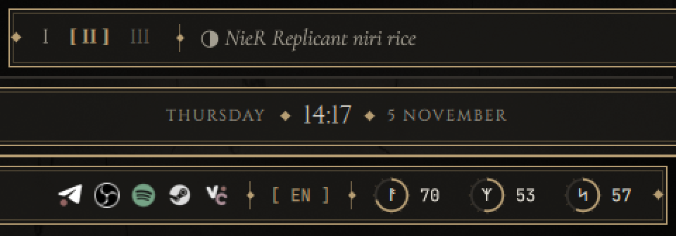
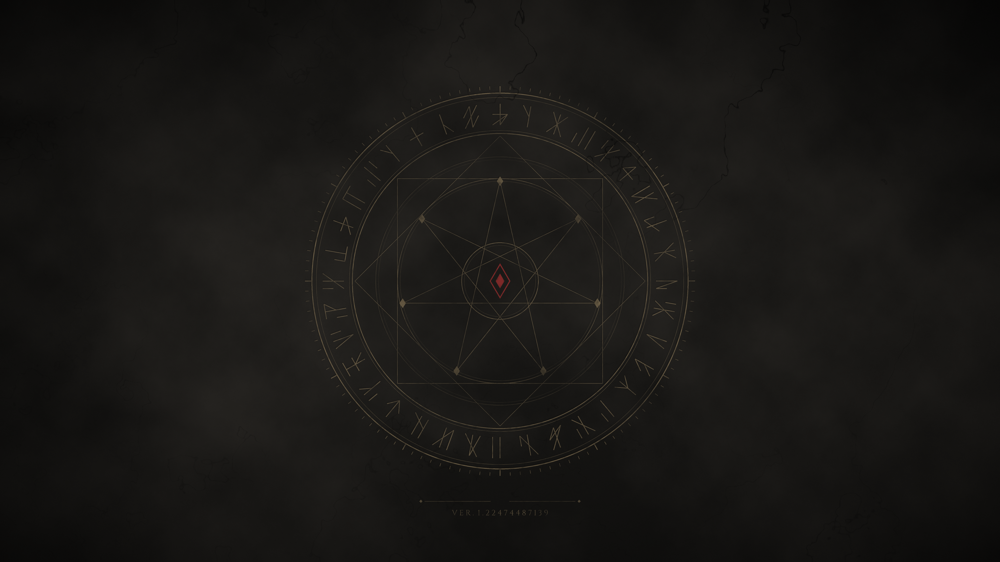

# NieR Replicant rice for niri

A desktop themed after *NieR Replicant ver.1.22474487139...*: weathered stone, faded bronze and
one drop of sealed-verse crimson, on [niri](https://github.com/YaLTeR/niri) and
[Quickshell](https://quickshell.org).

Several features follow ideas from [angelOS](https://github.com/MixaDoDs/AngelOS-Dotfiles) (MIT), reimplemented here.

A fan project, unaffiliated with Square Enix. The wallpaper is original procedural art
(`scripts/gen-wallpaper.py`) and no game assets are included.

## Install

For Arch-based systems:

    git clone https://github.com/EonKodein/nier-replicant-rice.git ~/nier-replicant-rice
    cd ~/nier-replicant-rice
    ./install.sh

The installer lists the files it will replace and asks first. Each one is backed up to
`~/.config/dotfiles_backup_<time>/`. Keep the clone: `nier-rice on` deploys from it.

| Flag | Effect |
|---|---|
| `--yes` | Don't ask |
| `--no-deps` | Skip packages |
| `--files-only` | Deploy files only: no packages, fonts, gsettings or process changes |

**Your niri config is replaced, not merged.** Move `output { }` blocks to
`~/.config/niri/monitor.kdl`. Put everything else of your own, such as keyboard layouts and extra
binds, in `~/.config/niri/local.kdl`. It is read last, and neither file is ever overwritten.

## Undo

    nier-rice off         # restore your previous files
    nier-rice uninstall   # the same, and delete everything the rice added
    nier-rice status

Log out and back in afterwards to get your previous session daemons back.

## What's included

| Part | Tool |
|---|---|
| Compositor | niri: 6px gaps, thin bronze borders, square corners |
| Bar and OSD | Quickshell: Roman numeral workspaces, serif clock, runic ring meters, tray, keyboard layout |
| Launcher | Quickshell: fuzzy search that also understands the Russian layout, `2+2*3`, `> command`, `web query` |
| Clipboard and session menus | Quickshell, cliphist |
| System load | Quickshell: CPU and memory rings in the bar (click for btop); heat and network on an empty workspace |
| Notifications | mako: parchment banners |
| Terminals | kitty, foot |
| Lock and wallpaper | swaylock-effects, swaybg, swayidle (locks before sleep) |
| Apps | GTK (over adw-gtk3-dark) and Qt (qt6ct) palettes |

Fonts are fetched from [google/fonts](https://github.com/google/fonts) under the SIL OFL into
`~/.local/share/fonts/nier-rice`: Cinzel, Cormorant Garamond, EB Garamond and JetBrains Mono.

## Keys

Tap `Mod` or `Mod+Space` launcher · `Mod+T` terminal · `Mod+E` files · `Mod+V` clipboard · `Mod+Alt+L` lock ·
`Mod+Shift+Q` session menu · `Mod+N` dismiss notification · `Mod+Shift+S` screenshot ·
`Mod+Tab` overview · `Mod+Shift+Escape` all keys

## Small things

- **Chapter card:** a brief `VERSE III` plate when you change workspace.
- **Living seal:** the crimson arc on the wallpaper tracks how much of the day has passed.
- **Now playing:** a ring in the bar shows track progress. Click to pause, scroll to change track.
- **Fastfetch:** a status screen with its own sigil. It runs automatically in fish, and
  `fastfetch -c nier` shows it anywhere.

## Layout

`home/` mirrors `$HOME`. Edit it, then run `nier-rice on`. In `home/.config/quickshell/nier/`:
`theme/` holds the palette and type, `services/` the system state, `widgets/` the frames and
meters, and `modules/` the bar and OSD.

## License

[GPL-3.0](LICENSE). This covers the code, configs and wallpaper. The fonts are downloaded at
install time and keep their own SIL OFL license.

---

## По-русски

Установка: `git clone https://github.com/EonKodein/nier-replicant-rice.git`, затем `./install.sh`. Установщик покажет, какие файлы заменит, и спросит
подтверждение. Откат: `nier-rice off`. Полное удаление: `nier-rice uninstall`. Конфиг niri
заменяется целиком: блоки `output` перенеси в `~/.config/niri/monitor.kdl`, а раскладки и свои
настройки укажи в `~/.config/niri/local.kdl`. Эти два файла установщик не перезаписывает.
