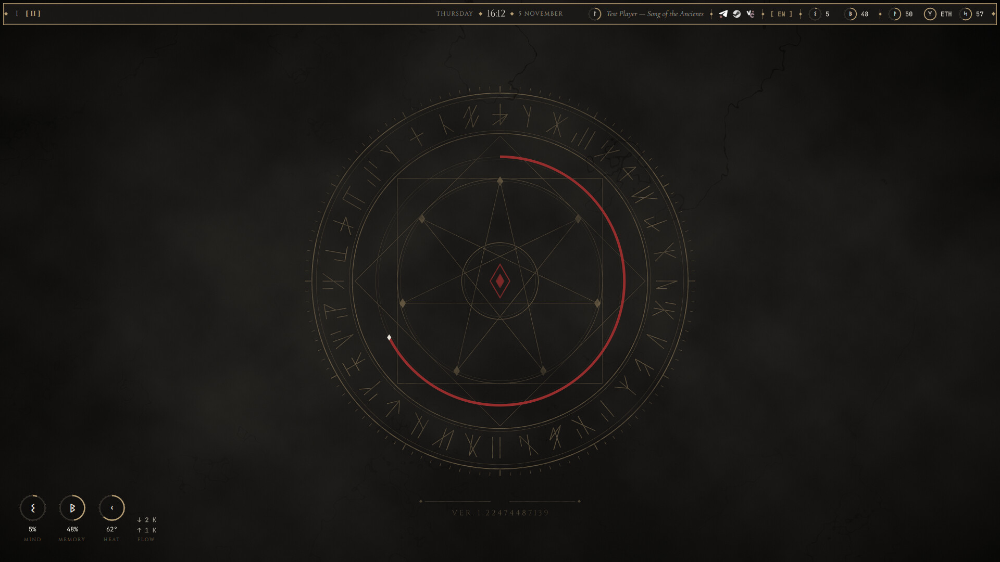
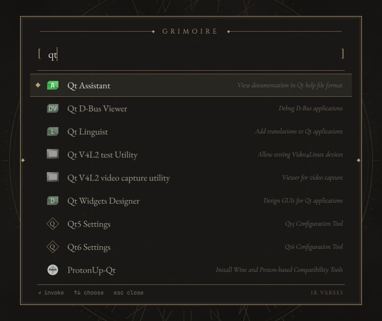
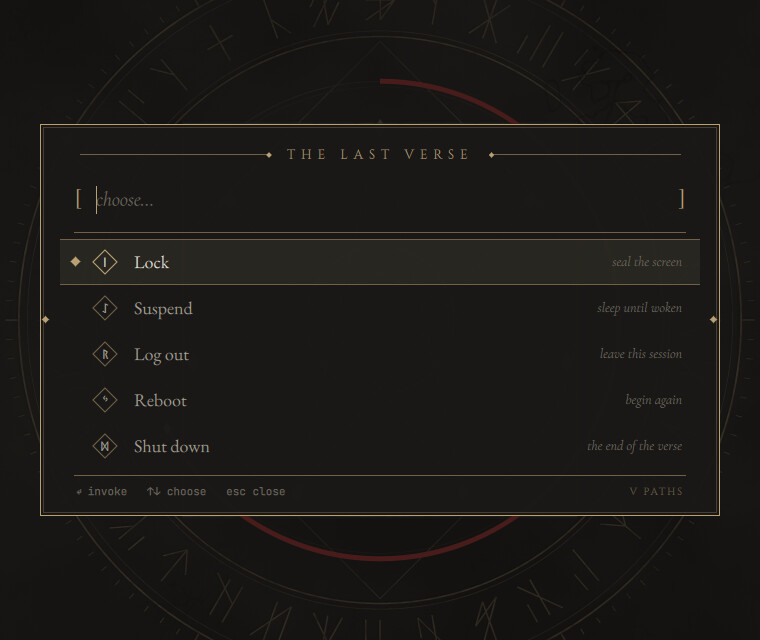
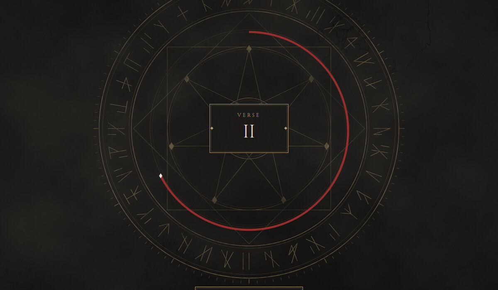
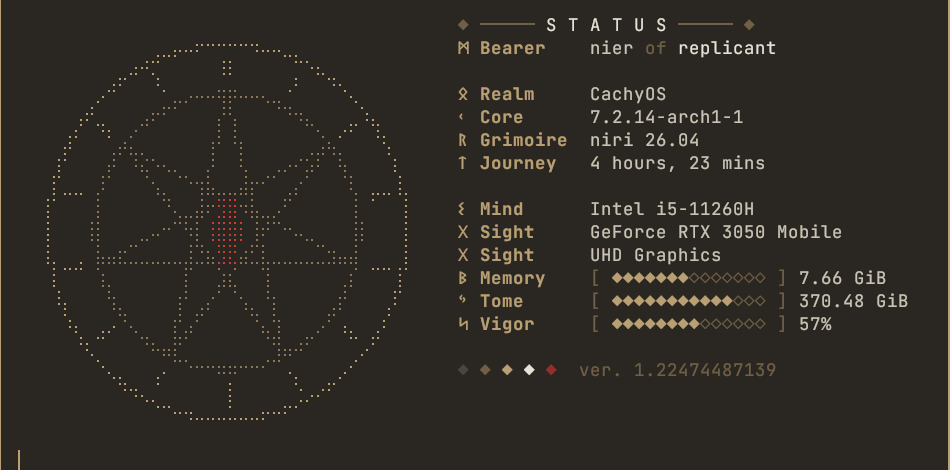
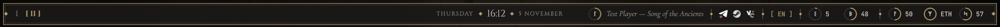
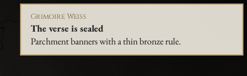

<div align="center">

# NieR Replicant rice для niri

**Выветренный камень, потускневшая бронза и капля багрянца запечатанного стиха.**

Цельный рабочий стол на [niri](https://github.com/YaLTeR/niri) и [Quickshell](https://quickshell.org) в стиле *NieR Replicant ver.1.22474487139...*

[](LICENSE)
[](https://github.com/YaLTeR/niri)
[](https://quickshell.org)
[](#установка)

[English](README.md) · **Русский**



</div>

## Галерея

| | |
| :-: | :-: |
|  |  |
| **Grimoire**, меню приложений | **The Last Verse**, меню питания |
|  |  |
| **Карточка главы** при смене стола | **Экран статуса** в fastfetch |



## Возможности

**Панель.** Рабочие столы римскими цифрами, часы с засечками, заголовок активного окна, трей, раскладка и рунические кольца для процессора, памяти, громкости, сети и батареи. Клик по кольцу нагрузки открывает `btop`.

**Меню.** Одно оформление на все три, отдельный лаунчер не нужен:

- **Grimoire** (нажатие `Mod` или `Mod+Space`): нечёткий поиск, который запоминает, что ты открываешь. Запрос на русской раскладке всё равно найдёт латинские названия: `ыеуфь` найдёт Steam. Ещё он понимает `2+2*3`, `> команда` и `web запрос`.
- **Chronicle** (`Mod+V`): история буфера обмена с поиском. `Enter` возвращает запись, `Del` удаляет.
- **The Last Verse** (`Mod+Shift+Q`): блокировка, сон, выход, перезагрузка, выключение.

**Мелочи.**

- **Живая печать:** багровая дуга на обоях показывает, сколько прошло от суток.
- **Карточка главы:** короткая табличка `VERSE III` при смене рабочего стола.
- **Музыка:** кольцо на панели показывает прогресс трека. Клик ставит на паузу, колесо переключает треки.
- **Показатели:** на пустом столе к нагрузке добавляются температура и сеть.
- **Уведомления-пергамент:** светлые плашки с тонкой бронзовой рамкой, у важных рамка багровая.



**Остальное в той же палитре:** kitty, foot, swaylock-effects, mako, приложения на GTK и Qt.

Обои — оригинальная процедурная графика (`scripts/gen-wallpaper.py`). Материалов из игры здесь нет.

## Установка

Для систем на базе Arch:

```bash
git clone https://github.com/EonKodein/nier-replicant-rice.git ~/nier-replicant-rice
cd ~/nier-replicant-rice
./install.sh
```

Установщик показывает, какие файлы заменит, и сначала спрашивает. Каждый файл копируется в `~/.config/dotfiles_backup_<время>/`, а если новый конфиг niri не проходит проверку, ничего не меняется. Клон не удаляй: `nier-rice on` берёт файлы из него.

| Флаг | Что делает |
| --- | --- |
| `--yes` | Не спрашивать |
| `--no-deps` | Пропустить пакеты |
| `--files-only` | Только файлы: без пакетов, шрифтов, gsettings и процессов |

> [!IMPORTANT]
> **Конфиг niri заменяется целиком, а не объединяется.** Блоки `output { }` перенеси в `~/.config/niri/monitor.kdl`. Всё остальное своё, например раскладки и дополнительные хоткеи, положи в `~/.config/niri/local.kdl`. Он читается последним, и оба файла никогда не перезаписываются.

Для открытия меню нажатием `Mod` нужна группа `input`: `sudo usermod -aG input $USER`, затем войди в систему заново. `Mod+Space` работает и без неё.

**Статус:** разрабатывается на CachyOS с niri 26.04 и Quickshell 0.3.2. Установщик проверен с `--files-only`, но полной установки на чистую систему ещё не было, так что сообщения об ошибках приветствуются.

## Откат

```bash
nier-rice off         # вернуть прежние файлы
nier-rice uninstall   # то же самое и удалить всё, что добавил рийс
nier-rice status      # показать, что запущено
```

После этого войди в систему заново, чтобы вернулись прежние службы сессии. `nier-rice` лежит в `~/.local/bin`.

## Клавиши

`Mod` — это Super. `Mod+Shift+Esc` показывает все сочетания на экране.

| Клавиши | Действие |
| --- | --- |
| нажатие `Mod`, `Mod+Space` | Меню приложений |
| `Mod+T` / `Mod+E` | Терминал / файлы |
| `Mod+V` | История буфера обмена |
| `Mod+Shift+Q` / `Mod+Alt+L` | Меню питания / блокировка |
| `Mod+N` / `Mod+Shift+N` | Скрыть / вернуть уведомление |
| `Mod+Shift+S` | Скриншот |
| `Mod+Tab` | Обзор |
| `Mod+1…9` / `Mod+Ctrl+1…9` | На стол / перенести туда колонку |
| `Mod+H`, `Mod+L`, стрелки | Фокус на колонки |
| `Mod+R` / `Mod+F` | Ширина колонки / полный экран |

## Шрифты

Скачиваются из [google/fonts](https://github.com/google/fonts) в `~/.local/share/fonts/nier-rice` по лицензии SIL OFL: Cinzel, Cormorant Garamond, EB Garamond и JetBrains Mono. Для рун используется Noto Sans Runic.

## Структура

`home/` повторяет `$HOME`. Правь файлы там, затем запускай `nier-rice on`.

```text
home/.config/quickshell/nier/
├── theme/      палитра, шрифты, размеры
├── services/   состояние niri, звука, питания, сети, системы и плеера
├── widgets/    рамки, кольца, страница меню
└── modules/    панель, лаунчер, буфер, питание, OSD, карточка главы, печать, показатели
```

## Благодарности

Часть функций основана на идеях [angelOS](https://github.com/MixaDoDs/AngelOS-Dotfiles) (MIT), код написан заново.

Фанатский проект, не связан со Square Enix. Лицензия: [GPL-3.0](LICENSE).
